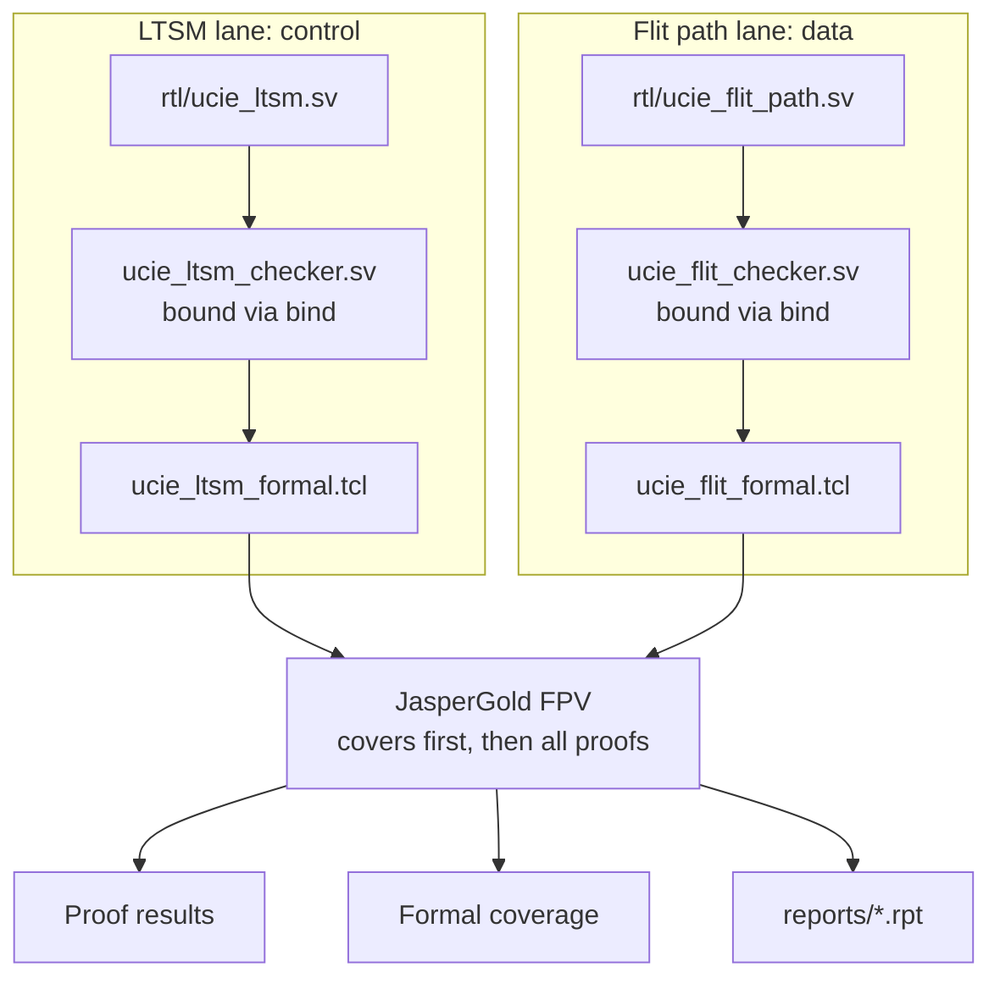

# UCIe LTSM Formal Verification (Cadence JasperGold)

Formal verification of a simplified UCIe-style link training state machine
(bring-up, retrain, L1/L2, error recovery, per-state timeout) using JasperGold FPV.

## Overview



## Structure

```
ucie_ltsm_formal_repo/
├── rtl/ucie_ltsm.sv                  # DUT 1: simplified link training FSM
├── rtl/ucie_flit_path.sv             # DUT 2: CRC-8 flit path with NAK/replay
├── formal/ucie_ltsm_checker.sv       # LTSM: safety, forward progress, spurious, covers
├── formal/ucie_ltsm_bind.sv
├── formal/ucie_flit_checker.sv       # flit path: data integrity (tracked-flit scoreboard)
├── formal/ucie_flit_bind.sv
├── scripts/ucie_ltsm_formal.tcl      # JasperGold flow, LTSM
├── scripts/ucie_flit_formal.tcl      # JasperGold flow, flit path
├── reports/
└── README.md
```

## Approach

- Checker is bound into `ucie_ltsm`; RTL is not modified.
- LTSM environment assumption: reset only at the start (once released it stays
  released). Sideband responses are unconstrained on purpose, so spurious
  responses are exercised and must be ignored.
- Safety: legal next-state relation for every state, valid encodings, guarded
  transitions (ACTIVE only via LINKINIT/PHYRETRAIN, LINKINIT only after a
  passing training response), link error and retrain/wake priority, and
  `sb_req_valid` matching the handshake states.
- Forward progress (the focus):
  * Bounded: every handshake state exits within `TIMEOUT` cycles, so no deadlock.
  * Unbounded: from any training state the machine eventually reaches ACTIVE or
    TRAINERROR (`s_eventually`), so no livelock. A failed training result is
    retried only until the timeout.
- Covers: every state, full bring-up, retrain and L1 round trips, failed-training
  retry, timeout to TRAINERROR, and recovery from TRAINERROR back to ACTIVE.
- Spurious / illegal events (LTSM): sideband responses with no request, training
  pass without a response, and upper-layer requests during training must not move
  the machine; each guarded transition requires its enabling response.
- Vacuity: every implication has a `cov_ante_*` cover on its antecedent, so a
  passing assertion that never fires shows up as an unreachable cover.

## Data integrity (flit path)

`ucie_flit_path` is a stop-and-wait flit path: CRC-8, 1-bit sequence number,
NAK/replay, with a free single-bit error injector on the link.

- A free, constant `tracked_idx` (stable by assume) selects which accepted flit
  to track. The scoreboard stores that flit's data on accept and compares it at
  delivery when the delivery count matches, which checks content, order and
  exactly-once delivery without per-flit queues.
- No phantom flits (delivery only for accepted flits); a corrupted frame is
  always detected by CRC and never delivered; a NAK always causes a clean replay
  on the next cycle; the replay buffer is stable while a flit is outstanding.
- Forward progress: an accepted flit is delivered within 4 cycles, even with an
  injected error.
- Environment assumptions: at most one corrupted transmission per flit (a replay
  is clean) and the error bit position lies within `{crc, data}`.
- Covers: error in data bits, error in CRC bits, corrupt then replayed delivery,
  tracked flit delivered after an error, two flits back to back.

## Run

```
jg -no_gui -tcl scripts/ucie_ltsm_formal.tcl
jg -no_gui -tcl scripts/ucie_flit_formal.tcl
```

Older installs: `jaspergold -no_gui -tcl scripts/<script>.tcl`.

## Coverage

Each Tcl flow runs in phases so coverage appears early instead of waiting for
the slowest proof:

1. Covers, then stimuli coverage (minutes; written to `*_phase1_stimuli.rpt`).
2. Safety assertions, with a status snapshot (`*_phase2_*.rpt`).
3. COI / proof / bound coverage, final summary and reports.
4. LTSM only: unbounded liveness, last and in its own task, after assuming the
   proven lemmas, so the hardest proof can never block coverage.

Every phase has its own time limit (variables at the top of each script) and
writes a snapshot, so partial results survive an interrupted run. The coverage
models and types:

- Stimuli: what the covers and assumptions actually exercised.
- COI / proof / bound: which logic the assertions depend on, which is fully
  covered by the proofs, and how deep bounded proofs reach.
- Models: branch, statement, toggle, expression.
- `check_cov` option values vary by JasperGold version, so every coverage call is
  wrapped and prints a warning instead of aborting the flow.

Outputs in `reports/`, prefixed `ltsm_` or `flit_`: per-phase status snapshots
(`*_phase*.rpt`, `*_final.rpt`), `*_summary.rpt`, coverage reports per type
(`*_phase1_stimuli.rpt`, `*_final_{stimuli,checker,formal,bounded}.rpt`) and
`*_uncovered_{stimuli,checker}.rpt`. Review the uncovered lists and any
unreachable covers to find missing properties or over-constraining assumptions.

## Results so far

Recorded from JasperGold sessions on this repo (LTSM unless noted). Re-run the
flows and update this table before quoting numbers.

| Item | Result |
|---|---|
| LTSM assertions (liveness assertion disabled) | 31 of 31 enabled proven; the two lemmas are now assumptions |
| LTSM covers | 59 of 59 enabled covers covered |
| LTSM stimuli coverage | 106 of 113 items covered, 0 uncovered, 5 unreachable, 2 dead code |
| LTSM checker stimuli coverage | 21 of 22 covered, 0 uncovered, 1 unreachable |
| `ast_live_training_resolves` | bounded (no cex to depth 230 after about 790 s), not proven |
| Flit path | phase 1: 0 unreachable covers; later phases not yet recorded here |

The 5 unreachable and 2 dead-code LTSM items still need to be named from the
uncovered reports; they are most likely unreachable by construction (for example
the `default` branch for encodings 9 to 15).

## Learnings and challenges

1. A "bounded N" result is not a proof, and it is not a bug.
   `ast_live_training_resolves` stayed bounded (depth 226, then 230) for over
   750 s, with no counterexample. The property is true by construction (every
   training state has a timeout), but the liveness engines kept exploring
   counter values the design never reaches. A real bug appears as `cex` with a
   trace.
   - Helper invariant `ast_inv_cnt_bounded` (`cnt < TIMEOUT` while training)
     proved in under 0.1 s.
   - Bounded form `ast_fp_training_resolves` (resolves within 4 x TIMEOUT
     cycles) proved for all time in 0.3 s. It logically implies the `s_eventually`
     property, so forward progress is established by the bounded form.
   - Even with both lemmas assumed, the unbounded engine did not close within
     the time spent. It is reported as bounded, implied by the proven form,
     rather than claimed as proven.
2. One slow property can stall everything in a single task. With the liveness
   assertion in the same task as the covers, the covers showed as undetermined
   with no traces and coverage stayed at 0 until it was disabled; the lemma
   `assume` commands appeared to reset cover results, and the script blocks on
   the long proof.
   - The flow is now phased: covers and stimuli coverage, safety proofs,
     COI/proof/bound coverage, and liveness last in its own task with a time cap.
   - A lemma is assumed only if it is actually proven.
3. Tool flow details cost real time.
   - `check_cov -init` with the expression model must run before `elaborate`
     (error `ECOV091`).
   - `check_cov -report -type all` is rejected by this version; valid values are
     `formal`, `stimuli`, `checker`, `bounded` (error `ESW053`).
   - A Tcl error aborts the script, so a late option mistake cost the proofs.
     Coverage calls are now wrapped in `catch` and print a warning instead.
   - `WPM042` ("no properties matched") is harmless; it appears when a status
     filter such as `unreachable` matches nothing.
4. Assumptions can hide the interesting cases. An early assumption that sideband
   responses only follow requests removed the illegal-event case. It was
   dropped, the DUT must now ignore spurious responses, and `ast_spur_*` check it.
5. Passing is not the same as meaningful. Every implication has a `cov_ante_*`
   cover, so an assertion whose antecedent never occurs shows up as an
   unreachable cover instead of a silent pass. Coverage is read together with
   the proofs: covers first, then COI, proof and bound coverage.
6. Keeping the data-integrity model small. The tracked flit index is a constant
   free input and errors are limited to one per flit (a replay is clean). This
   keeps the scoreboard small while the index is still free, but multi-bit and
   burst errors are out of scope.

## Notes

- The DUT is a small teaching model, not the UCIe spec LTSM. To target real RTL,
  replace `rtl/`, keep the checker port names (or edit the bind), and update the
  state encodings in the checker.
- The flit path is a simplified model, not the UCIe D2D adapter: stop-and-wait
  instead of a sequence-numbered replay buffer, an 8-bit payload with CRC-8, and
  a clean ack channel. The single-bit-error guarantee relies on the CRC property
  that every single-bit error is detected; multi-bit or burst errors are out of
  scope.
- Check all covers (including every `cov_ante_*`) are reachable before trusting
  assertion passes.
- Keep `TIMEOUT` small for fast convergence; raise it once the flow is stable.
- A liveness assertion (`s_eventually`) reported as "bounded N" means no
  counterexample up to depth N, not a proof. `ast_live_training_resolves` is
  helped by the invariant `ast_inv_cnt_bounded` (proved first, then assumed) and
  backed by the safety form `ast_fp_training_resolves` (4 x TIMEOUT cycles).
- Not a signoff-complete proof.
